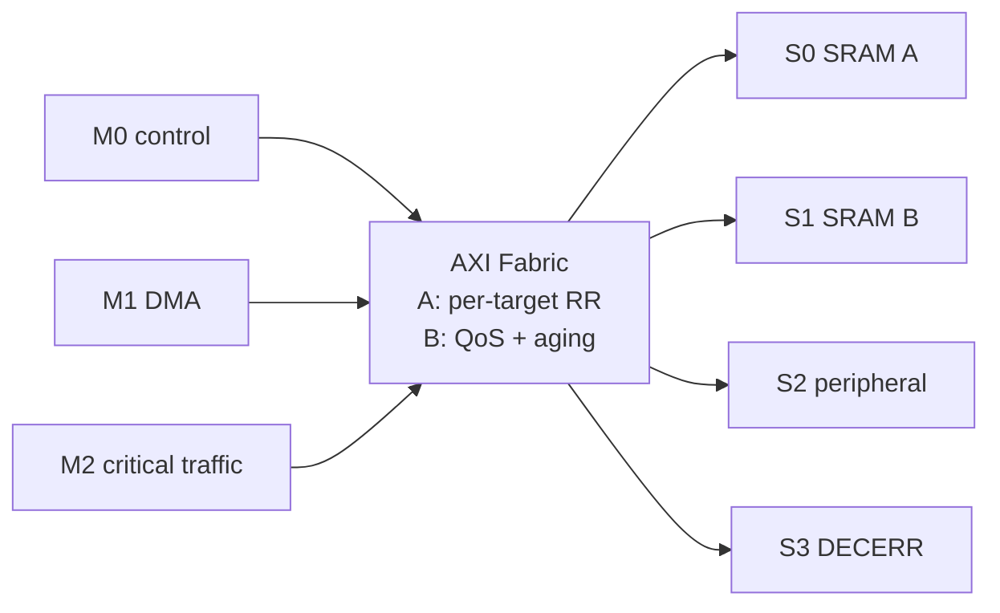
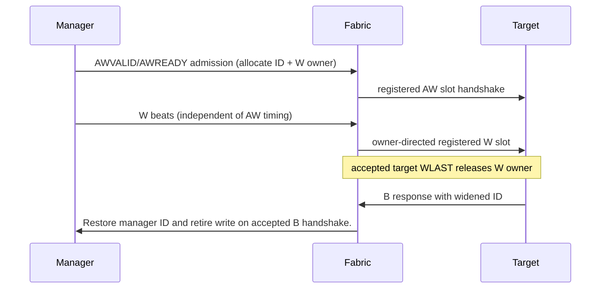
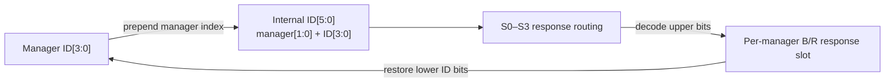
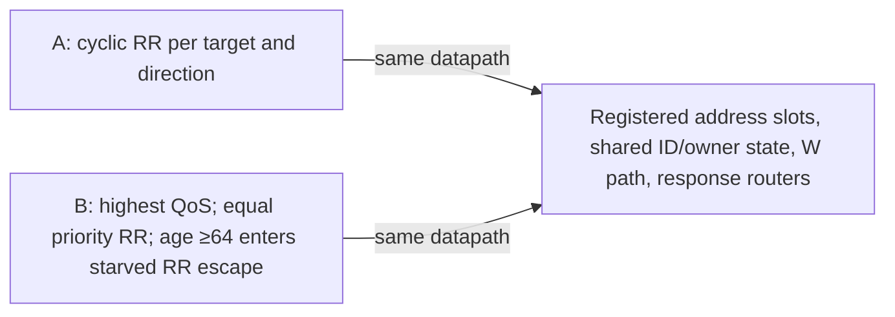
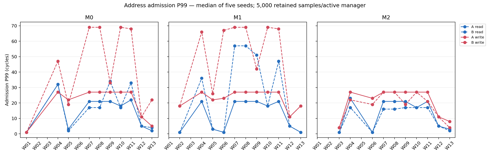
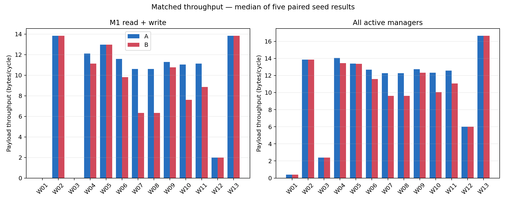
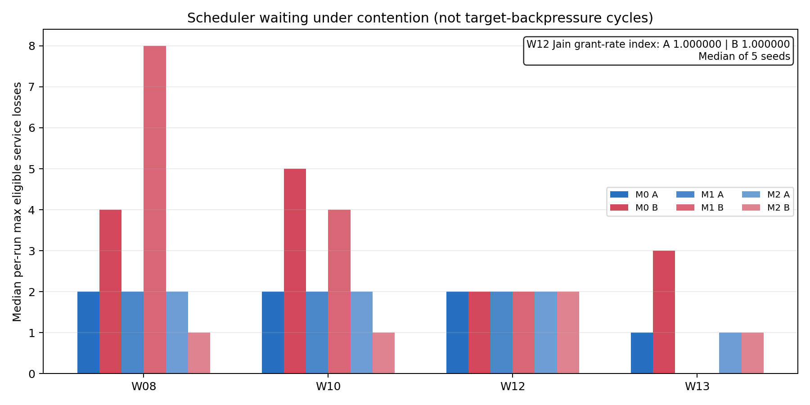
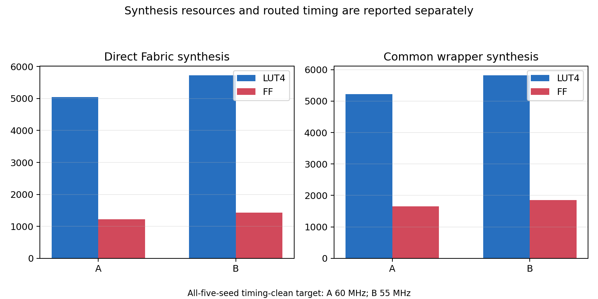

# Fabric Under Pressure

An RTL/SoC case study of a small multi-manager AXI interconnect: how should latency-sensitive traffic share targets with a bandwidth-hungry DMA? The project builds and verifies two controlled scheduler policies, measures them on identical synthetic workloads, and reports the trade-offs—including where the QoS policy loses.

**Result:** Architecture B improves the frozen W08 M2 read-admission P99 from 21 to 16 cycles, but fails D045 overall. M1 combined payload throughput falls about 40%, M0 write-admission P99 rises from 27 to 69 cycles, and the common-wrapper five-seed timing-clean target falls from 60 to 55 MHz. The conclusion is evidence-based rejection of B under the frozen criteria, not a claim that QoS is universally harmful.

## Design

The Fabric connects three independent managers to four logical targets. S0/S1 model SRAM regions, S2 a peripheral region, and S3 returns decode errors for unmapped requests.



The project implements a **documented AXI4 subset**, not full AXI4 compliance: 64-bit data, 32-bit addresses, 4-bit manager IDs, aligned 8-byte INCR bursts of 1–16 beats, and no 4-KiB crossing. FIXED bursts and broader AXI features are excluded; see [requirements](docs/REQUIREMENTS.md).

AW and W are independent. AW admission allocates shared manager write state and an unfinished-W owner. W routes from that registered owner until the accepted target WLAST releases it; B completion retires the outstanding write. Two manager-ID bits are prepended downstream and restored from BID/RID. Reads and writes have separate four-entry-per-manager outstanding tracking; same-direction ID reuse is blocked until completion.







Architecture A uses round robin. Architecture B adds 4-bit QoS preference and per-requester 8-bit saturating age with threshold 64 and RR starvation escape. D045 froze the B hypothesis before implementation. The A/B experiment changed scheduling policy and age state while retaining the common datapath, buffers, endpoints, plans, and tools.

## Verification and measurement

The independent Python oracle and whole-DUT cocotb regressions cover routing, IDs, outstanding limits, write ownership, response integrity, backpressure, reset and legal ordering. Targeted formal runs prove bounded component properties under stated assumptions; they are not an exhaustive whole-Fabric proof. Gate-3 includes five frozen random seeds at 512 and 2,048 operations, directed four-outstanding tests, and integrated AW/AR fairness.

Canonical W00–W13 workloads use seeds `0xFABC0001`–`0xFABC0005`; each active manager has 500 warm-up and 5,000 retained completions. The endpoint is a deterministic model (queue depth 8, two-cycle read-start and B latency, one R beat/cycle), not a production-memory timing claim. A and B use the same intent hashes and benchmark engine. Percentiles use NumPy 2.3.5 `method="nearest"`, with per-seed metrics and median-of-five aggregation.

### Frozen D045 results

| Criterion | A | B | Result |
|---|---:|---:|---|
| W08 M2 read-admission P99 | 21 cycles | 16 cycles | PASS (B target ≤16) |
| W08 M1 read+write throughput | 10.607 B/cycle | 6.341 B/cycle | FAIL (−40.2%; minimum 10.077) |
| W08 M0 read-admission P99 | 21 cycles | 17 cycles | PASS (maximum 23) |
| W08 M0 write-admission P99 | 27 cycles | 69 cycles | FAIL (maximum 29) |
| W12 Jain grant-rate index | 0.99999997 | 0.99999997 | PASS (minimum 0.98) |

B also increases W08 M1 read admission P99 from 21 to 57 cycles and write admission P99 from 27 to 69 cycles. M2 benefits in W08, while M1 service and M0 writes regress. W12 equal-demand fairness remains near one. W13 records concurrent progress to independent targets in both architectures.

### Plots

All figures are generated from processed run records; values are not hand-entered.









### ECP5 implementation comparison

Fixed wrapper and LFE5U-45F/CABGA381/speed-grade-6 flow, seeds 1–5:

| Metric | A | B | Change |
|---|---:|---:|---:|
| Direct Fabric LUT4 | 5,046 | 5,730 | +13.6% |
| Direct Fabric FF | 1,219 | 1,426 | +17.0% |
| Wrapper LUT4 | 5,226 | 5,826 | +11.5% |
| Wrapper FF | 1,649 | 1,856 | +12.6% |
| Highest tested all-seed timing-clean target | 60 MHz | 55 MHz | −5 MHz |

The observed B critical path runs from manager AW address input logic to manager AWREADY through the QoS/age arbitration selection. A's example path runs through the AW address/owner path to the registered target AW slot. This is a fixed-wrapper comparison, not general timing signoff or a universal Fmax claim.

The recorded implementation toolchain is Yosys 0.69+75, nextpnr-ecp5 0.11.1-30-g3e53a0bf and Project Trellis 1.4-82-g3afe7b5. Simulation records Verilator 5.053-devel and Python 3.11.6. Per-run exact versions and source hashes are under each local raw-results root.

## Reproduction

### Source map

| Area | Contents |
|---|---|
| [`rtl/`](rtl/) | Architecture A/B Fabric and shared channel, tracking, decode and response modules |
| [`tb/directed/`](tb/directed/) | Whole-DUT and focused SystemVerilog checks |
| [`tb/cocotb/`](tb/cocotb/) | Oracle-connected random qualification and benchmark driver |
| [`tb/model/`](tb/model/) | Independent endpoint and transaction reference models |
| [`formal/`](formal/) | Bounded properties, assumptions and cover harnesses |
| [`bench/`](bench/) | Frozen workloads and measurement/analysis scripts |
| [`scripts/`](scripts/) | Reproduction, regression, synthesis and route entry points |
| [`docs/`](docs/) | Requirements, decisions, methods, limitations and evidence index |
| [`results/processed/`](results/processed/) | Reviewed summaries and data-derived figures |

One-time setup prompts are retained under [`docs/history/`](docs/history/) for provenance; they are not current project instructions.

The shell runners source [`scripts/oss_cad_env.sh`](scripts/oss_cad_env.sh). They require OSS CAD Suite release `20260920`, defaulting to `~/eda/fabric-under-pressure/oss-cad-suite`, and fail instead of silently selecting another installed Verilator/Yosys/SBY/nextpnr. To use the same release from another location, set the root explicitly:

```bash
export OSS_CAD_SUITE_ROOT=/path/to/oss-cad-suite
```

Run from the repository root on the qualified macOS Apple-Silicon host with the pinned Python environment:

```bash
ARCH_BENCH_OUT_ROOT=results/raw/arch_a_matched_v2 ./scripts/run_arch_a_benchmark.sh
ARCH_BENCH_OUT_ROOT=results/raw/arch_b_full_v1 ./scripts/run_arch_b_benchmark.sh
ARCH_A_PPA_OUT=results/raw/arch_a_ppa_matched_v1 ./scripts/run_arch_a_ppa.sh
ARCH_PPA_ARCH=B ARCH_A_PPA_OUT=results/raw/arch_b_ppa_matched_v1 ./scripts/run_arch_a_ppa.sh
.venv/bin/python bench/summarize_benchmark.py results/raw/arch_a_matched_v2
.venv/bin/python bench/summarize_benchmark.py results/raw/arch_b_full_v1
.venv/bin/python bench/compare_ab.py results/raw/arch_a_matched_v2 results/raw/arch_b_full_v1 results/processed/ab_comparison
.venv/bin/python bench/plot_ab_comparison.py
```

PPA commands execute the frozen 55-route sweep per architecture. Tool versions, source manifests, plan hashes, JUnit files and raw event logs are preserved under `results/raw/` on the measurement host. The compact processed comparison is in [`results/processed/ab_comparison/summary.md`](results/processed/ab_comparison/summary.md).

The complete A/B matrices, D045 evaluation, 55-route-per-architecture ECP5 sweeps and four figures were reproduced from a fresh clone at the reviewed comparison commit. The run used the qualified Apple-Silicon host and its shared, digest-pinned OSS CAD Suite; it is a clean-source reproduction, not independent-hardware validation. The reproduction record and compact outputs are in [`results/processed/gate5_reproduction/summary.md`](results/processed/gate5_reproduction/summary.md).

## Decision and limits

D047 records **REJECT B under the frozen D045 criteria**: two required criteria fail materially. The policy's M2 benefit is real, but the DMA throughput and M0 write-tail costs violate the predeclared limits. The algorithm and hypothesis were not tuned after seeing results.

The project used substantial ChatGPT/Codex assistance in technical planning, RTL/test implementation, debugging and evidence processing. File-by-file authorship is not fully recorded; see [development provenance](docs/DEVELOPMENT_PROVENANCE.md) and the [provenance review](portfolio_audit/ai_authorship_review.md). Original setup prompts and task history remain under [`docs/history/`](docs/history/). No third-party Fabric logic is imported. The model does not establish unrestricted AXI4 compliance, production-memory latency, exhaustive whole-Fabric formal proof, board-level timing signoff, or a universal performance result. Architecture B remains a measured experimental variant; Architecture C, CDC, and any future B redesign are outside this comparison.
