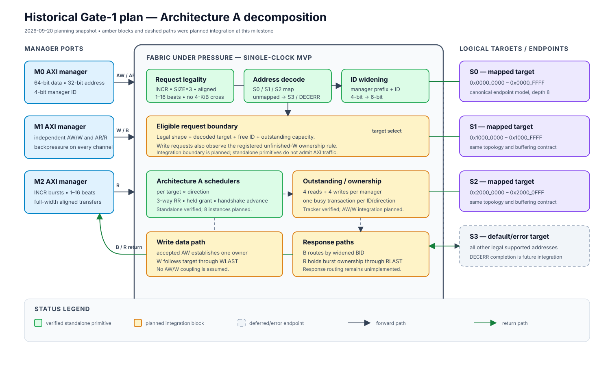

# Architecture-A overview

**Historical Gate-1 planning diagram (2026-09-20).** It shows the proposed decomposition before the whole-Fabric implementation. Amber blocks and dashed paths are planning boundaries, not current missing integration. For the implemented Architecture-A/B topology, channel paths and evidence, see the [README](../README.md) and [`MICROARCHITECTURE.md`](MICROARCHITECTURE.md).

The diagram is an original project visual and does not copy technical architecture from the reference figure. It is retained to document the design-planning stage and is not a source-derived RTL schematic.
